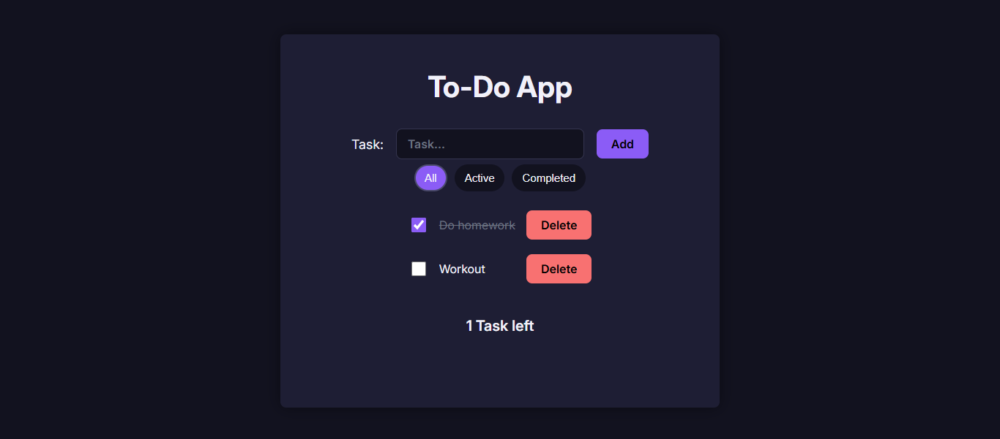

# To-Do App

A responsive to-do app built with HTML, CSS and JavaScript, with tasks saved in localStorage.

🔗 **Live Demo:** https://amir0rr.github.io/To-Do-App/



## Features

- Add, delete and complete tasks
- Tasks are saved in localStorage and stay after a page refresh
- Filter tasks by all, active and completed
- Remaining tasks counter
- Empty state messages that change with the selected filter
- Dark theme with a responsive layout (desktop, tablet, mobile)

## Built With

- HTML5
- CSS3 (Flexbox, media queries)
- JavaScript (DOM manipulation, events, array methods)

## What I Learned

- Building responsive layouts with Flexbox and media queries
- Creating and updating DOM elements with JavaScript
- Managing a list of tasks as an array of objects (add, delete with `filter`, toggle)
- Saving and loading data with localStorage, `JSON.stringify` and `JSON.parse`
- Filtering a list with a state variable, `dataset` and `classList`
- Counting items with `filter` and `length`

## Run Locally

```bash
git clone https://github.com/Amir0rr/To-Do-App.git
```

Then open `index.html` in your browser.